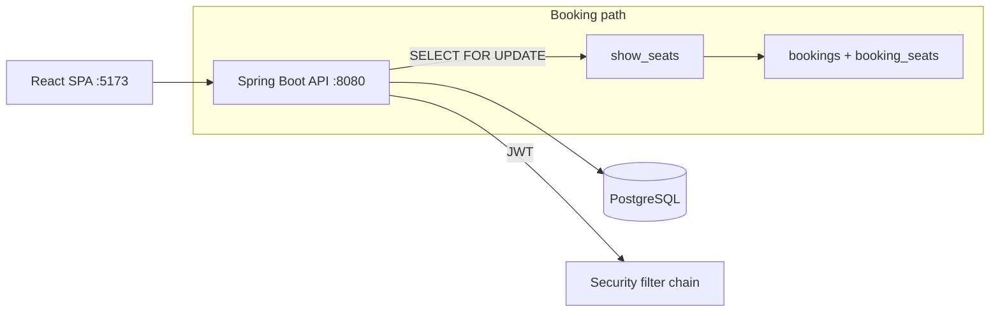

# BookMyShow Clone — Concurrency-Safe Movie Ticket Booking

Full-stack movie ticket booking system: **Spring Boot 3 / Java 21** backend, **PostgreSQL**, **React 19 + Vite** frontend.

This is a backend-hardened redesign of the original prototype. The headline fix is **race-free seat booking** via a per-show seat inventory table with pessimistic locking, DB uniqueness, and idempotent retries — plus JWT auth, Flyway migrations, pagination, and regression tests.

## What changed from the prototype

| Area | Before | Now |
|---|---|---|
| Booking | check-then-act, double-books under load | `show_seats` inventory + `PESSIMISTIC_WRITE` + `UNIQUE(show_id, seat_id)` + `Idempotency-Key` |
| Auth | plaintext password, `GET /users` leaked hashes | BCrypt-12, JWT (access token), no password in any response |
| Movies API | duplicate `@GetMapping("/genre/{x}")` — app failed startup | `/genre/{genre}` + `/language/{language}`, paginated |
| Errors | `500` returned as `400`, stack leaks | RFC 7807 `ProblemDetail` (`409` conflict, `404` not-found, `500` real) |
| DB | `ddl-auto=update` + `TRUNCATE` seed on boot | Flyway `V1__baseline.sql`, `validate`, indexes (incl. `pg_trgm`), Hikari pool |
| Lists | unbounded `findAll()` | `Page<T>` everywhere |
| CORS | `allowedOrigins("*")` | allowlist via `CORS_ALLOWED_ORIGINS` |
| Docker | ran as root, no healthcheck | non-root `app` user, `HEALTHCHECK /actuator/health` |

## Architecture



Key tables: `users`, `movies`, `theaters`, `screens`, `seats`, `shows`, **`show_seats(show_id, seat_id UNIQUE, status)`**, `bookings(idempotency_key UNIQUE)`, `booking_seats`.

## API (base `/api` — legacy — and `/api/v1`)

| Method | Endpoint | Auth | Notes |
|---|---|---|---|
| POST | `/users/register` | no | `201`, BCrypt hash, validates email/password≥8 |
| POST | `/users/login` | no | returns `{ accessToken, userId, email, role }` |
| GET | `/users`, `/users/{id}` | — | paginated, **never returns password** |
| GET | `/movies?page=&size=` | no | paginated |
| GET | `/movies/{id}`, `/movies/search?title=`, `/movies/genre/{g}`, `/movies/language/{l}` | no | |
| GET | `/shows`, `/shows/{id}`, `/shows/movie/{id}`, `/shows/movie/{id}/date?date=` | no | |
| GET | `/theaters`, `/theaters/{id}`, `/theaters/city/{cityId}` | no | |
| GET | `/cities`, `/cities/{id}` | no | |
| POST | `/bookings` | **yes** (`Bearer`) | `201`, supports `Idempotency-Key` header or `idempotencyKey` body |
| GET | `/bookings/{id}`, `/bookings/user/{uid}?page=` | yes | |
| PUT | `/bookings/{id}/cancel` | yes | releases `show_seats` → `AVAILABLE` |
| GET | `/bookings/show/{showId}/available-seats` | no | |

Error shape (RFC 7807): `{ type, title, status, detail, timestamp }`. Double-book → `409 Seat with id X is already booked`.

## Booking concurrency design

1. Client sends `POST /bookings { userId, showId, seatIds, idempotencyKey? }` (or `Idempotency-Key` header).
2. Server: idempotency short-circuit → `SELECT ... FOR UPDATE` on `show_seats` rows → validate `AVAILABLE` + same screen → mark `BOOKED` → insert `bookings` — all in one transaction.
3. Unique constraints (`show_seats`, `bookings.idempotency_key`) make the DB the final arbiter. Retries with the same key return the original row.

Proven by `BookingConcurrencyTest`: 2 threads × same seat → exactly 1 win + 1 `409`.

## Quick start

### 1. Backend

Requirements: JDK 21, Maven 3.9+, PostgreSQL 15+.

```bash
createdb BMS
# env (or edit application.properties defaults)
export SPRING_DATASOURCE_URL=jdbc:postgresql://localhost:5432/BMS
export SPRING_DATASOURCE_USERNAME=postgres
export SPRING_DATASOURCE_PASSWORD=123
export APP_JWT_SECRET="<at-least-32-bytes-random-string>"
export CORS_ALLOWED_ORIGINS=http://localhost:5173

mvn spring-boot:run
# Swagger: http://localhost:8080/swagger-ui/index.html
# Health:  http://localhost:8080/actuator/health
```

Flyway migrates automatically (`V1__baseline.sql` with indexes + `pg_trgm`). `ddl-auto=validate` — schema changes go in new `db/migration/Vn__*.sql` files.

### 2. Frontend

```bash
cd frontend
npm install
npm run dev
# http://localhost:5173
```

The SPA still calls `/api/...` — both `/api` and `/api/v1` are served, so no frontend change required. Paginated responses are `Page` objects (`content`, `totalElements`, ...); update grids to read `.content` when you adopt `size` params.

### 3. Docker

```bash
docker build -t bms .
docker run -p 8080:8080 \
  -e SPRING_DATASOURCE_URL=jdbc:postgresql://host.docker.internal:5432/BMS \
  -e SPRING_DATASOURCE_USERNAME=postgres \
  -e SPRING_DATASOURCE_PASSWORD=123 \
  -e APP_JWT_SECRET="<64-char-secret>" bms
```

## Tests

```bash
mvn test -Dtest=BookingConcurrencyTest   # concurrency + idempotency (H2, no Postgres needed)
mvn package -DskipTests                  # build jar -> target/BMS-*.jar
```

## Configuration reference

| Key | Default | Purpose |
|---|---|---|
| `SPRING_DATASOURCE_URL` | `jdbc:postgresql://localhost:5432/BMS` | JDBC URL |
| `SPRING_DATASOURCE_USERNAME/PASSWORD` | `postgres/123` | DB creds |
| `DB_POOL_SIZE` | `20` | Hikari max pool |
| `APP_JWT_SECRET` | dev placeholder | **Must override in prod (≥32 bytes)** |
| `CORS_ALLOWED_ORIGINS` | `http://localhost:5173` | comma-separated allowlist |

## Project structure

```text
src/main/java/com/cfs/BMS/
├── config/        # SecurityConfig, CorsConfig, OpenApiConfig
├── security/      # JwtUtil, JwtAuthFilter (stateless, Bearer)
├── controller/    # Booking, Movie, Show, Theater, Screen, Seat, City, User
├── service/       # BookingService (locked), UserService (BCrypt+JWT), ...
├── repository/    # + ShowSeatRepository (pessimistic locks)
├── entity/        # Booking(idempotencyKey, version), ShowSeat, User(role)
├── enums/         # BookingStatus, SeatHoldStatus, SeatType, UserRole
├── exception/     # ProblemDetail handler + typed exceptions
└── dto/           # validated requests, AuthResponse
src/main/resources/db/migration/V1__baseline.sql
src/test/.../BookingConcurrencyTest.java
frontend/          # React 19 + Vite + TS
```

## Production notes / next steps

- Short-lived JWT (15 min) + refresh rotation, RBAC enforcement on admin routes.
- Redis seat-hold with TTL (10 min) + Kafka outbox → payment saga → notifications.
- Read replica for catalog, `pg_trgm`/FTS tuning for search, rate limiting (Bucket4j), tracing (Micrometer).
